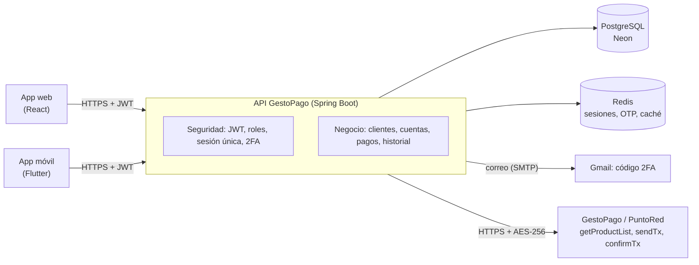
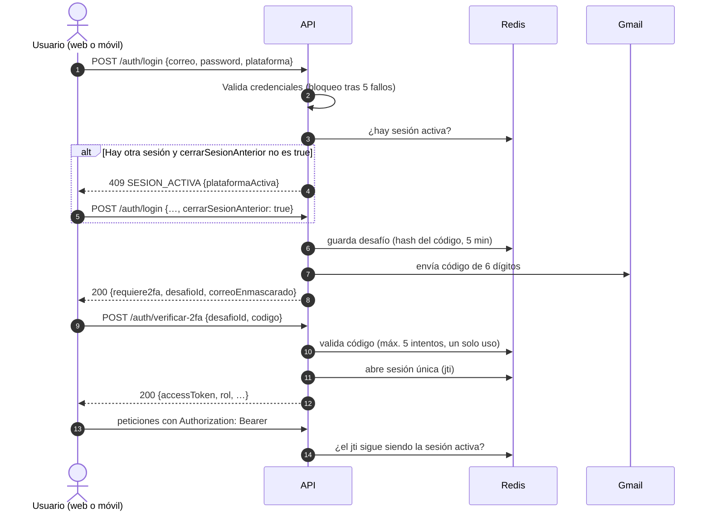

# GestoPago · Documentación de integración (Unidad II)

Ecosistema de comercio digital: **aplicación web (React)** y **aplicación móvil (Flutter)** sobre **una sola API REST**
(este backend, Spring Boot). Ninguna de las dos aplicaciones duplica lógica de negocio: validaciones, sesión única, 2FA,
saldos y pagos viven en el servidor, y el servidor es quien se comunica con el proveedor **GestoPago / PuntoRed**.

- **URL base (producción):** `https://gestopago-bmb0.onrender.com`
- **Documentación interactiva (Swagger UI):** `https://gestopago-bmb0.onrender.com/swagger-ui/index.html`
- **Formato:** JSON (`Content-Type: application/json`), HTTPS en producción.

---

## 1. Arquitectura



| Pieza | Responsabilidad |
|---|---|
| **PostgreSQL** | Clientes, usuarios, cuentas, transacciones, bitácora de pagos y catálogo respaldado. Migraciones con Flyway. |
| **Redis** | Sesión activa por usuario, desafíos 2FA, contadores de intentos y caché del catálogo. |
| **GestoPago** | Catálogo de productos y procesamiento real del pago (`sendTx` / `confirmTx`). Nada se simula. |

---

## 2. Convenciones

### Autenticación
Todos los endpoints requieren `Authorization: Bearer <accessToken>`, excepto `POST /auth/login`, `POST /auth/verificar-2fa`,
`POST /clientes` (registro) y la documentación (Swagger, `/actuator/health`).

### Datos sensibles fuera de la URL
Ningún endpoint de negocio lleva identificadores ni datos en la ruta o en la query. Los datos viajan en el **body** (POST/PUT/DELETE)
y las credenciales/llaves en **headers** (`Authorization`, `Idempotency-Key`).

### Envoltorio de respuesta
Las respuestas de negocio (y todos los errores) usan:

```json
{
  "timestamp": "2026-11-10T01:21:52.515",
  "status": 200,
  "mensaje": "Consulta realizada correctamente",
  "datos": { },
  "detalles": { }
}
```

`datos` aparece en éxito; `detalles` aparece en errores de validación o de pago. Las excepciones, que no usan envoltorio, son
`/auth/login`, `/auth/verificar-2fa` y el catálogo (`/productos*`, `/getProductList`), que devuelven su objeto directo.

### Roles
`CLIENTE` (usuario final de las apps) y `ADMIN` (operación y conciliación). Un cliente solo puede operar sobre **sus propios**
recursos; si intenta otro, recibe `403`.

---

## 3. Flujo de acceso (login + 2FA + sesión única)



- **Una sola sesión por usuario.** Al iniciar en otra plataforma se pide cerrar la anterior (`cerrarSesionAnterior: true`); el token
  de la sesión anterior deja de funcionar de inmediato.
- **Expiración automática:** el token y la sesión duran 60 minutos (configurable con `APP_JWT_EXPIRATION_MS`).
- **Logout seguro:** `POST /auth/logout` elimina la sesión en el servidor (el token queda inservible aunque no haya vencido).
- **2FA validado en el servidor:** el código se guarda solo como hash, vence en 5 minutos, admite 5 intentos y se usa una sola vez.

---

## 4. Endpoints

### 4.1 Autenticación

#### `POST /auth/login`: paso 1 (credenciales + envío del código)
| | |
|---|---|
| **Acceso** | Público |
| **Body** | `correo` (obligatorio, email, máx. 100) · `password` (obligatorio) · `plataforma` (`WEB` o `MOVIL`; por defecto `WEB`) · `cerrarSesionAnterior` (boolean, opcional) |

Respuesta `200`:
```json
{ "requiere2fa": true, "desafioId": "b3f1…", "correoEnmascarado": "u***@gmail.com", "expiraEnSegundos": 300 }
```

| Código | Cuándo |
|---|---|
| `400` | Body inválido (correo mal formado, plataforma distinta de WEB/MOVIL…) |
| `401` | Credenciales inválidas (mismo mensaje exista o no el correo) |
| `403` | Usuario o cliente inactivo |
| `409` | Ya hay una sesión activa. `detalles`: `{error: "SESION_ACTIVA", plataformaActiva: "MOVIL"}` |
| `429` | Demasiados intentos fallidos (bloqueo de 15 min tras 5) o demasiados códigos enviados (5 cada 15 min) |
| `503` | No fue posible enviar el correo con el código |

#### `POST /auth/verificar-2fa`: paso 2 (código + entrega del token)
| | |
|---|---|
| **Acceso** | Público |
| **Body** | `desafioId` (obligatorio, máx. 64) · `codigo` (obligatorio, exactamente 6 dígitos) |

Respuesta `200`:
```json
{ "accessToken": "eyJ…", "tokenType": "Bearer", "correo": "u@gmail.com",
  "usuarioId": 4, "clienteId": 3, "rol": "CLIENTE" }
```
Errores: `400` (formato), `401` (código incorrecto, vencido o ya usado), `409` (apareció otra sesión entre el paso 1 y el 2), `429` (más de 5 intentos).

#### `POST /auth/logout`
Requiere token. Cierra la sesión del token enviado. `200` `{mensaje: "Sesión cerrada correctamente"}`; `401` sin token válido.

### 4.2 Catálogo de productos

| Método y ruta | Descripción |
|---|---|
| `GET /productos/almacenados` | **Recomendado para las apps.** Catálogo desde Redis, con respaldo en PostgreSQL y, si no hay nada, consulta a GestoPago. |
| `GET /productos` | Consulta en vivo a GestoPago y actualiza Redis y PostgreSQL. |
| `GET /getProductList` | Igual que `/productos`; pensado para diagnóstico (ver nota). |

Respuesta `200` (objeto directo):
```json
{
  "codigo": 0, "mensaje": "Operacion realizada con exito", "origen": "REDIS",
  "productos": [
    { "idProducto": 209, "producto": "Telcel $150", "idServicio": 79, "servicio": "Telcel",
      "idCatTipoServicio": 1, "tipoFront": 1, "precio": 150.00, "legend": "…",
      "logoUrl": "https://gestopago.portalventas.net/sistema/images/gestopago/servicios/79.png",
      "disponibleParaCompra": true, "montoLibre": false, "categoria": "Recargas y tarjetas" }
  ]
}
```
- `logoUrl`: imagen PNG pública del servicio; se obtiene con `idServicio` (`getServiceLogo` de GestoPago). Si el servicio no tiene logo la URL responde `404`; la app debe mostrar un ícono de respaldo.
- `tipoFront 1`: `precio` es el monto a cobrar. `tipoFront 2`: `precio` es la comisión.
- `disponibleParaCompra`: `true` si el producto se puede comprar desde esta API (`tipoFront` 1 con precio, o 2). Las apps deben ocultar o deshabilitar los que vengan en `false`.
- `montoLibre`: `true` en pago de servicios (`tipoFront` 2): el cliente captura el importe. En `false` el importe es el `precio` fijo.
- `categoria`: "Recargas y tarjetas" (`tipoFront` 1), "Pago de servicios" (`tipoFront` 2) u "Otros". El proveedor solo entrega un número en `idCatTipoServicio`, sin nombre; para agrupar por empresa use `servicio`.
- Errores: `503` (sin token activo de GestoPago), `502` (GestoPago no respondió o respondió algo inválido).
- **Nota:** `GET /getProductList` equivale a `/productos`. El header `Authorization` es siempre el JWT de esta API; solo para diagnóstico se puede forzar un token del proveedor con el header opcional `X-GestoPago-Token`. Las apps usan `/productos/almacenados`.

### 4.3 Compra de servicios

#### `POST /pagos/servicio`
| | |
|---|---|
| **Acceso** | Solo el titular de la cuenta (`@PreAuthorize`) |
| **Headers** | `Authorization` · `Idempotency-Key` **obligatorio** (8 a 64 caracteres: letras, números, guion o guion bajo). Se genera uno nuevo por cada compra; se reutiliza solo para reintentar la misma compra. |
| **Body** | `numeroCuenta` (16 dígitos) · `pin` (4 dígitos) · `monto` (> 0, máx. 13 enteros y 2 decimales) · `telefonoReferencia` (letras/números, máx. 100) · `idServicio` · `idProducto` · `tipoFront` (todos enteros positivos) |

Respuesta `200` (compra exitosa):
```json
{
  "status": 200, "mensaje": "Pago realizado correctamente",
  "datos": {
    "estadoCompra": "EXITOSA", "idTransaccion": 99, "repetida": false,
    "numeroCuenta": "1234567890123456", "monto": 150.00, "saldoRestante": 850.00,
    "idServicio": 79, "idProducto": 209, "producto": "Telcel $150", "referencia": "5512345678",
    "comision": 3.00, "idTxGestoPago": "GP-1", "numAutorizacion": "AUT-1",
    "fecha": "…", "pinProducto": null, "leyenda": null
  }
}
```

**Estados de la compra.** Solo `EXITOSA` cuenta como compra realizada.

| `estadoCompra` | Significado | Cómo llega |
|---|---|---|
| `EXITOSA` | GestoPago confirmó la compra | `200`, en `datos.estadoCompra` |
| `RECHAZADA` | No se realizó (saldo insuficiente, PIN incorrecto, referencia inválida, rechazo de GestoPago); no se cobró o ya se devolvió | error, en `detalles.estadoCompra` |
| `PENDIENTE` | GestoPago no respondió a tiempo o ya hay un pago en proceso; el monto queda retenido hasta confirmar. Incluye `detalles.idTransaccion` | error, en `detalles.estadoCompra` |
| `ERROR_COMUNICACION` | Sin conexión con GestoPago, respuesta ilegible o problema técnico; el `detalle` indica si el monto quedó retenido | error, en `detalles.estadoCompra` |

Si el servidor responde `500` sin `estadoCompra`, la app debe tratarlo como `ERROR_COMUNICACION`.

Ejemplo de error (`422`, saldo insuficiente):
```json
{ "status": 422, "mensaje": "El saldo de la cuenta es insuficiente para realizar el pago",
  "detalles": { "codigo": "1005", "error": "SALDO_INSUFICIENTE", "estadoCompra": "RECHAZADA" } }
```

Idempotencia: repetir la solicitud con la misma `Idempotency-Key` devuelve el resultado guardado (`repetida: true`) sin cobrar de nuevo.

#### `POST /pagos/estado`
Consulta en qué terminó una compra (útil para una compra `PENDIENTE`). Solo `CLIENTE`, solo compras propias.
Body `{"idTransaccion": 99}` → `datos`: `{idTransaccion, estadoCompra, mensaje}`. `404` si no existe o no es del usuario.

### 4.4 Historial de compras

Solo rol `CLIENTE`; muestra únicamente compras **exitosas** de las cuentas del usuario.

#### `POST /pagos/historial`
Body (opcional): `{"pagina": 0, "tamano": 20}` (`tamano` entre 1 y 50). Más recientes primero.
```json
{ "status": 200, "mensaje": "Historial de compras",
  "datos": { "contenido": [ { "idTransaccion": 99, "fecha": "2026-11-10T10:00:00-06:00",
      "idProducto": 209, "idServicio": 79, "producto": "Telcel $150", "referencia": "5512345678",
      "monto": 150.00, "comision": 3.00, "idTxGestoPago": "GP-1", "numAutorizacion": "AUT-1",
      "cuenta": "************3456", "estatus": "EXITOSA" } ],
    "pagina": 0, "tamano": 20, "totalElementos": 1, "totalPaginas": 1 } }
```

#### `POST /pagos/historial/detalle`
Body `{"idTransaccion": 99}` → misma estructura de una compra. `404` si no existe, no es del usuario o no fue exitosa (no se distingue, para no filtrar información).

### 4.5 Cuentas y PIN

| Endpoint | Acceso | Body | Respuesta |
|---|---|---|---|
| `POST /cuentas/buscar` | ADMIN (cualquier criterio) o CLIENTE (solo su `numeroCuenta`) | `numeroCuenta` (16 dígitos, opcional) · `activas` (boolean) | Lista de cuentas |
| `POST /cuentas/saldo` | ADMIN o titular | `numeroCuenta` | `{numeroCuenta, saldo, estatus}` |
| `POST /cuentas/abono` | ADMIN | `numeroCuenta` · `monto` (> 0) | Saldo actualizado |
| `POST /cuentas/pin` | Titular | `numeroCuenta` · `pinNuevo` (4 dígitos) · `pinActual` (obligatorio si ya hay PIN) | `200` sin datos |

El PIN se guarda con hash; tras 5 intentos fallidos al pagar se bloquea 15 minutos (`423`).

### 4.6 Clientes y usuarios

| Endpoint | Acceso | Descripción |
|---|---|---|
| `POST /clientes` | Público | Registro de cliente (crea usuario y cuenta). `201`. Validaciones: nombre/apellidos, fecha de nacimiento pasada, CURP, RFC, correo, teléfono de 10 dígitos, domicilio y contraseña fuerte. `409` si CURP, RFC o correo ya existen. |
| `POST /clientes/buscar` | ADMIN, o CLIENTE solo con su `id` | Búsqueda combinable (id, curp, rfc, correo, nombre, apellido, fechas…) con banderas `incluirDomicilio/Cuentas/Usuario`. |
| `PUT /clientes` | ADMIN o el propio cliente | Actualiza datos del cliente. |
| `DELETE /clientes` | ADMIN | Baja lógica. Body `{"id": 3}`. |
| `POST /usuarios/consultar` | ADMIN o el propio usuario | Body `{"id": 4}`. |
| `PUT /usuarios/password` | ADMIN o el propio usuario | `id` · `passwordActual` · `nuevaPassword` (mín. 8, mayúscula, minúscula, número y carácter especial). |
| `DELETE /usuarios` | ADMIN | Baja lógica. Body `{"id": 4}`. |

### 4.7 Conciliación (solo ADMIN)

| Endpoint | Descripción |
|---|---|
| `POST /pagos/conciliacion/pendientes` | Lista transacciones sin resultado confirmado. |
| `POST /pagos/conciliacion/ejecutar` | Ejecuta ya la conciliación con `confirmTx` (también corre cada 2 min). |
| `POST /pagos/conciliacion/resolver` | Resuelve manualmente. Body: `idTransaccion` · `accion` (`CONFIRMAR` o `REVERTIR`) · `observacion` (máx. 200). |

---

## 5. Códigos de estado HTTP

| Código | Uso |
|---|---|
| `200` / `201` | Operación correcta / recurso creado |
| `400` | Solicitud inválida (validaciones del body, `Idempotency-Key` faltante o mal formada) |
| `401` | Sin token, token vencido o sesión reemplazada, credenciales o código 2FA inválidos |
| `403` | Sin permisos sobre el recurso, usuario inactivo o PIN incorrecto |
| `404` | Recurso inexistente o ajeno |
| `409` | Sesión activa en otra plataforma, duplicados, pago en proceso |
| `422` | Regla de negocio (saldo, monto, cuenta inactiva, referencia, rechazo de GestoPago) |
| `423` | PIN bloqueado temporalmente |
| `429` | Demasiados intentos |
| `502` / `503` / `504` | Proveedor o correo no disponible, o sin respuesta a tiempo |

## 6. Códigos de error del pago (`detalles.codigo`)

| Código | Error | HTTP | Estado de compra |
|---|---|---|---|
| 1001 | `CUENTA_NO_ENCONTRADA` | 404 | RECHAZADA |
| 1002 | `CUENTA_NO_ACTIVA` | 422 | RECHAZADA |
| 1003 | `PIN_NO_CONFIGURADO` | 422 | RECHAZADA |
| 1004 | `PIN_INCORRECTO` | 403 | RECHAZADA |
| 1005 | `SALDO_INSUFICIENTE` | 422 | RECHAZADA |
| 1006 | `PRODUCTO_NO_ENCONTRADO` | 404 | RECHAZADA |
| 1007–1008 | `SERVICIO_NO_COINCIDE`, `TIPO_FRONT_NO_COINCIDE` | 422 | RECHAZADA |
| 1009 | `IDEMPOTENCY_KEY_REUTILIZADA` | 422 | RECHAZADA |
| 1010 | `PAGO_EN_PROCESO` | 409 | PENDIENTE |
| 1011 | `PAGO_PREVIO_FALLIDO` | 409 | RECHAZADA |
| 1012 | `PIN_BLOQUEADO` | 423 | RECHAZADA |
| 1013–1016 | `MONTO_NO_COINCIDE`, `MONTO_EXCEDE_LIMITE`, `TIPO_FRONT_NO_SOPORTADO`, `REFERENCIA_INVALIDA` | 422 | RECHAZADA |
| 1017 | `PRECIO_NO_DISPONIBLE` | 503 | ERROR_COMUNICACION |
| 1018 | `IDEMPOTENCY_KEY_INVALIDA` | 400 | RECHAZADA |
| 1101 | `GESTOPAGO_RECHAZADO` | 422 | RECHAZADA |
| 1102–1103 | `GESTOPAGO_NO_DISPONIBLE`, `GESTOPAGO_RESPUESTA_INVALIDA` | 502 | ERROR_COMUNICACION |
| 1104 | `GESTOPAGO_TOKEN_NO_DISPONIBLE` | 503 | ERROR_COMUNICACION |
| 1105 | `FIRMA_NO_CONFIGURADA` | 500 | ERROR_COMUNICACION |
| 1106 | `GESTOPAGO_DUPLICADO` | 409 | RECHAZADA |
| 1107 | `GESTOPAGO_TIMEOUT` | 504 | PENDIENTE |

---

## 7. Seguridad

| Medida | Implementación |
|---|---|
| Transporte | HTTPS en Render (HSTS activo). |
| Autenticación | JWT firmado (HS256) con `jti` por sesión; el secreto exige 32 caracteres o más y se valida al arrancar. |
| Segundo factor | OTP de 6 dígitos por correo, validado en el servidor (hash, 5 min, 5 intentos, un solo uso, 5 envíos por 15 min). |
| Sesión única | Redis `sesion:usuario:{id}`; un login nuevo exige cerrar la sesión previa; el filtro rechaza tokens con `jti` distinto. |
| Expiración | Token y sesión vencen a los 60 minutos. |
| Fuerza bruta | 5 credenciales incorrectas seguidas bloquean el correo 15 minutos; el mensaje de error no revela si el correo existe. |
| Control de acceso | `@PreAuthorize` por rol y por propiedad del recurso (`@accesos`). |
| Credenciales | Contraseñas y PIN con BCrypt; secretos solo por variables de entorno. |
| Validación | Bean Validation en cada body; reglas de monto y de producto en el servidor. |
| Errores | Respuestas uniformes sin trazas ni datos internos; el texto del proveedor se guarda solo en bitácora. |
| Pagos | Idempotencia, bloqueo de fila al mover saldo, payload cifrado AES-256-CBC, conciliación automática. |
| CORS | Solo los orígenes de `APP_CORS_ALLOWED_ORIGINS` (por defecto `http://localhost:5173`). La app Flutter nativa no usa CORS. |

---

## 8. Servicios de GestoPago consumidos

| Servicio del proveedor | Para qué | Quién lo invoca |
|---|---|---|
| Autenticación (JWT del proveedor, 24 h) | Token de distribuidor; se renueva una vez al día | El backend (tarea programada) |
| `GET getProductList` (respuesta XML) | Catálogo de productos y precios | `GET /productos*` |
| `POST sendTx` (payload AES-256) | Ejecutar el pago | `POST /pagos/servicio` |
| `POST confirmTx` | Confirmar si una operación sin respuesta se aplicó | Conciliación |
| `GET getServiceLogo` | Logo PNG por `idServicio` | Las apps, vía `logoUrl` |

Tiempo de espera de `sendTx`: 70 s (el proveedor responde código 82 tras 62 s). Sin reintentos automáticos en operaciones financieras.

## 9. Variables de entorno

| Variable | Uso |
|---|---|
| `DB_URL`, `DB_USER`, `DB_PASSWORD` | PostgreSQL (Neon) |
| `SPRING_DATA_REDIS_URL` | Redis |
| `APP_JWT_SECRET` | Firma del JWT (32 caracteres o más) |
| `GESTOPAGO_AUTH_PASSWORD`, `GESTOPAGO_CRYPTO_KEY`, `GESTOPAGO_CRYPTO_IV`, `GESTOPAGO_API_KEY` (opcional) | Proveedor |
| `SPRING_MAIL_HOST`, `SPRING_MAIL_USERNAME`, `SPRING_MAIL_PASSWORD` | Correo del código 2FA (Gmail con contraseña de aplicación) |
| `APP_ADMIN_CORREO`, `APP_ADMIN_PASSWORD` | Admin inicial |
| `APP_CORS_ALLOWED_ORIGINS` | Orígenes permitidos para la web |
| `APP_JWT_EXPIRATION_MS` | Vigencia de la sesión (opcional) |

---

## 10. Flujo de evaluación mapeado a los endpoints

| Paso del escenario | Endpoint |
|---|---|
| Iniciar sesión en la app móvil | `POST /auth/login` con `plataforma: "MOVIL"` |
| Completar el 2FA | `POST /auth/verificar-2fa` |
| Consultar el catálogo | `GET /productos/almacenados` |
| Seleccionar un producto y comprar | `POST /pagos/servicio` |
| Ver el historial con la compra exitosa | `POST /pagos/historial` y `POST /pagos/historial/detalle` |
| Intentar entrar desde la web | `POST /auth/login` con `plataforma: "WEB"` → `409 SESION_ACTIVA` (`plataformaActiva: MOVIL`) |
| Cerrar la sesión anterior e iniciar en la web | `POST /auth/login` con `cerrarSesionAnterior: true` → `POST /auth/verificar-2fa` (el token móvil deja de funcionar) |
| Consultar de nuevo catálogo e historial | Los mismos endpoints con el token de la web |
